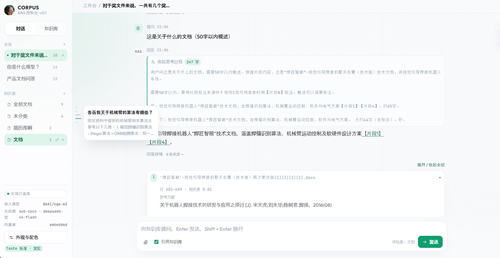
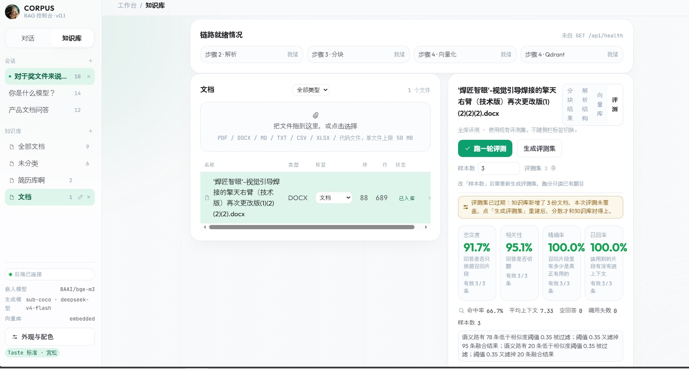
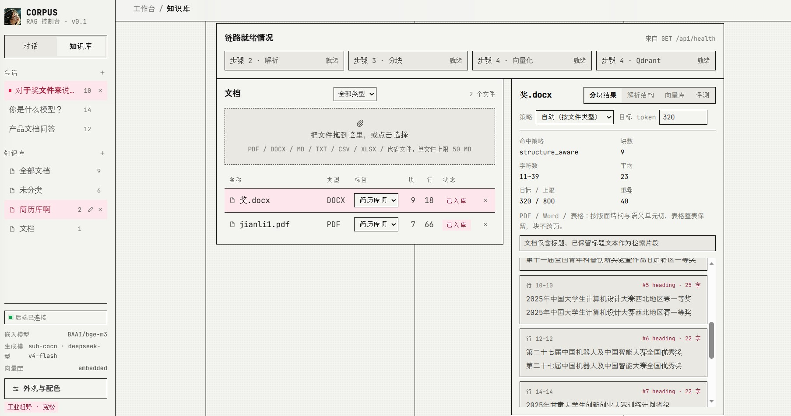

# CORPUS · RAG 控制台

对话 + 文件上传的本地 RAG 工作台：把 PDF / Word / Markdown / 表格 / 代码丢进知识库，
按标签分组入库，用「BM25 关键字 + 向量语义」混合检索，再让大模型带着【片段 N】引用回答，
最后用 RAGAS 四项指标给整条链路打分。

分步实现，每一步都能单独跑、单独看结果；进度总览见 [步骤.md](步骤.md)，
设计语言沿用 `web/` 里的静态原型与 `skills/` 规范。

## 界面速览







> 三张图取自真实运行界面（`web/image-zs/`），分别对应「对话」「知识库 / 评测」「分块详情」。

## 它能做什么

| 能力 | 现状 |
| --- | --- |
| 多格式解析 | PDF / DOCX / Markdown / TXT / CSV / Excel / 代码，统一产出带行号与结构标签的块 |
| 分块策略 | 自动按文件类型路由：代码按函数（AST）、Markdown 按标题、Word/PDF 结构感知、纯文本按段落 |
| 向量化与入库 | 硅基流动 `BAAI/bge-m3` 远程 embedding，写入 Qdrant（embedded 本地模式，免 Docker） |
| 混合检索 | BM25 + 向量双路召回，RRF 融合（只看排名不看分数），再经 `bge-reranker-v2-m3` 重排 |
| 对话生成 | 原生 SSE 流式输出，回答带【片段 N】引用，可展开推理过程与检索诊断（两路各召回多少、融合多少、是否重排） |
| 知识库分组 | 一级标签分类，聊天 / 入库 / 搜索 / 清空统一按当前分类操作；移动分类复用已有向量，无需重新入库 |
| 评测 | RAGAS 四项指标（忠实度 / 相关性 / 精确率 / 召回率）+ 命中率与逐条样本明细，历史跑分落盘 |
| 追踪 | LangSmith（默认关闭，按需开启） |
| 界面外观 | 四套设计语言 × 六种强调色 × 字号档位，令牌驱动，不改结构换皮 |

## 快速开始

```powershell
# 后端
cd backend
Copy-Item .env.example .env      # 然后填入 API Key
.\scripts\install.ps1            # 建 .venv 并装依赖
.\scripts\run_dev.ps1           # http://127.0.0.1:5000

# 前端（另开一个终端）
cd frontend
npm install
npm run dev                     # http://127.0.0.1:5173
```

打开 http://127.0.0.1:5173 ，侧栏底部显示「后端已连接」即联通成功。
Vite 已把 `/api` 代理到 5000 端口，前端代码里只写相对路径。
会话与消息存在浏览器 `localStorage`，刷新后仍在；知识库分组与文档归属由后端持久化。

首次使用建议顺序：**知识库页上传文件 → 向量库「增量入库」→ 回对话页提问 → 评测面板「生成评测集 / 跑一轮评测」**。

## 项目结构

```
rag指标/
├─ 步骤.md / revise.md / agents.md   ← 进度、改动方案、模型迁移记录
├─ web/                              ← 第一版静态原型（视觉基准）
│  └─ image-zs/                      ← README 中的界面截图
├─ skills/                           ← 设计语言规范（前端令牌按它实现）
├─ docs/                             ← 每一步的验收截图与验证记录
├─ scripts/                          ← Playwright 端到端校验 / 截图脚本
├─ backend/                          ← Flask 后端
│  ├─ app/
│  │  ├─ api/                        ← 路由：health / documents / index / chunks / knowledge_bases / chat / eval
│  │  ├─ ingest/                     ← loaders（解析）+ chunking（分块策略与路由）
│  │  ├─ retrieval/                  ← embedder / vector_store / bm25 / hybrid / rerank / context / indexer
│  │  ├─ llm/                        ← 统一生成客户端（主 DeepSeek + GLM 备用回退）
│  │  ├─ eval/                       ← RAGAS 评测集与跑分
│  │  └─ rag.py query.py config.py   ← 检索编排、查询改写、配置
│  ├─ scripts/                       ← 冒烟测试、定向探测、服务启动
│  ├─ tests/                         ← 离线回归（178 项）
│  └─ data/                          ← 上传文件、Qdrant 本地库、注册表、评测报告
└─ frontend/                         ← Vue 3 + Vite + TypeScript
   └─ src/
      ├─ components/                 ← ChatView / KnowledgeView / EvalPanel / AppSidebar …
      ├─ composables/                ← useWorkspace（会话与状态）/ useStyle（外观）/ useBackend
      ├─ api/client.ts               ← fetch + SSE 解析（唯一终态校验）
      ├─ utils/markdown.ts           ← Markdown 渲染 + 危险内容清洗
      └─ styles/tokens.css           ← 主题与强调色令牌
```

## 架构与数据流

```
上传 → 解析（loaders）→ 分块（chunking 策略路由）→ embedding → Qdrant
                                                              │
提问 ─┬─ BM25 关键字召回（jieba 分词） ──┐                     │
      └─ 向量语义召回 ──────────────────┴→ RRF 融合 → rerank → 上下文拼装
                                                              │
                                        生成模型（SSE 流式）→ 回答 +【片段 N】引用
                                                              │
                                        RAGAS 评测（生成 + 裁判）→ 四项指标 + 逐条明细
```

关键接口：`GET /api/health`（链路状态）、`POST /api/documents`（上传解析）、
`POST /api/index`（增量入库）、`POST /api/chat`（SSE 流式问答）、`POST /api/eval/*`（出题与跑分）。

## 技术栈

整体是一套「Vue 前端 + Flask 后端 + 远程模型 API + 本地向量库」的轻量全栈方案：
不在本机跑任何模型推理，embedding / 重排 / 生成全部走兼容 [OI] 协议的远程服务，
所以不需要 GPU，也不需要下载 2 GB 权重。

**端到端技术链路**

```
浏览器（Vue 3 单页应用）
   │  fetch + SSE（EventSource 语义，手写解析）
   ▼
Flask 后端（Blueprint 分层）
   ├─ 解析层：pypdf / python-docx / openpyxl / markdown-it / tree-sitter
   ├─ 检索层：jieba + rank-bm25 ＋ httpx → 硅基流动 embedding → Qdrant
   └─ 生成层：httpx → sub-coco DeepSeek（备用：智谱 GLM）
                                    └─ RAGAS + LangChain Judge → 评分报告
```

**前端**

| 项 | 内容 |
| --- | --- |
| 框架 | Vue 3（`<script setup>` + Composition API，单页应用） |
| 构建 | Vite 6 + TypeScript 5.6，`@` 别名指向 `src/` |
| 语言 | TypeScript，`vue-tsc` 做类型检查 |
| 状态 | 自研 composable：`useWorkspace`（会话 / 消息 / 知识库）、`useStyle`（外观）、`useBackend`（健康轮询） |
| 网络 | 原生 `fetch` + 手写 SSE 解析（`src/api/client.ts`），非 EventSource、非 AI SDK |
| 渲染 | `markdown-it` 渲染回答 + `dompurify` 清洗危险内容 |
| 样式 | 原生 CSS 令牌（`styles/tokens.css`）：4 套设计语言 × 6 种强调色 × 4 档字号 |
| 可选依赖 | `@ai-sdk/vue` / `ai` 已装但**未接入主链路**，留给后文的 AI SDK 增强层 |
| 测试 | `node --test` 原生测试运行器（12 项离线回归） |
| 开发代理 | Vite 把 `/api` 代理到 `127.0.0.1:5000`，前端代码只写相对路径 |

**后端**

| 项 | 内容 |
| --- | --- |
| 框架 | Flask 3.1，按 Blueprint 分层（`api/` 只做路由，业务在 service 模块） |
| CORS | `flask-cors`，仅放行本地前端端口 |
| 语言 / 运行时 | Python，`venv` 虚拟环境，`python-dotenv` 读取 `.env` |
| 流式输出 | 生成器 + SSE，事件类型 `sources / reasoning / content / notice / done / error` |
| 文档解析 | `pypdf`（PDF）、`python-docx`（Word）、`openpyxl`（Excel）、`markdown-it-py`、`beautifulsoup4` |
| 代码分块 | `tree-sitter` + `tree-sitter-language-pack`（按语言 AST 切函数） |
| 中文分词 | `jieba`，用于 BM25 关键字路 |
| HTTP 客户端 | `httpx`（调 embedding / 重排 / 生成模型），`openai` SDK 供 RAGAS Judge 使用 |
| 数值 | `numpy`（向量与相似度计算） |
| 测试 | `pytest`（178 项离线回归，模型请求走 MockTransport） |

**数据与存储**

| 项 | 内容 |
| --- | --- |
| 向量库 | Qdrant（`embedded` 本地文件模式，免 Docker；可切 `server` 模式连服务） |
| 向量化 | 硅基流动 `BAAI/bge-m3`，1024 维，远程 API |
| 重排 | 硅基流动 `BAAI/bge-reranker-v2-m3` |
| 检索 | BM25 关键字 + 向量语义双路，RRF 融合（`RRF_K=60`）后重排 |
| 元数据 | JSON 文件：文档注册表、知识库分类注册表、索引状态、评测报告 |
| 上传文件 | 本地目录 `backend/data/uploads/`，测试可重定向到 `data/tmp/` |
| 会话 | 浏览器 `localStorage`（未迁移到 IndexedDB） |

**模型服务**

| 角色 | 提供方 / 模型 | 说明 |
| --- | --- | --- |
| 主生成 | sub-coco `deepseek-v4-flash` | [OI] 兼容接口，`https://www.sub-coco.com/v1` |
| 备用生成 | 智谱 `glm-4-flash` | **独立地址与凭据**，仅在主模型可恢复故障时切换并弹通知 |
| 评测裁判 | sub-coco `deepseek-v4-flash` | LangChain Judge 独立路径，不走业务客户端 |
| 评测框架 | RAGAS 0.2.x + `datasets` | faithfulness / answer_relevancy / context_precision / context_recall |
| 追踪 | LangSmith | 默认关闭，按需开启 |

**工具链**

| 项 | 内容 |
| --- | --- |
| 一键脚本 | `backend/scripts/install.ps1`（建环境 + 装依赖 + 自检）、`run_dev.ps1`（启动服务） |
| 冒烟测试 | `smoke_step1.py` ~ `smoke_step6_api.py`、`smoke_all.py`，均带 `--no-llm` 离线入口 |
| 端到端校验 | Playwright（`scripts/verify_*.mjs`）：真实浏览器 + 截图 + 控制台错误断言 |
| 真实模型验证 | `backend/scripts/verify_live_models.py`（分阶段：长输出 / 回退 / 全流程 / 评测） |
| 质量对比 | `backend/scripts/compare_step7.py`（查询改写 A/B） |
| 视觉基准 | `web/` 静态原型 + `skills/` 设计语言规范 + `scripts/shoot.mjs` 截图 |

## 项目重难点

按「踩过的坑有多深」排序，每条都对应代码里的具体取舍。

**1. 模型故障不能悄悄降级：主备双连接 + 用户可见通知**

主模型（sub-coco DeepSeek）与备用（智谱 GLM）使用**各自的 base_url、api_key、模型名与输出预算**，
不能把 DeepSeek 的超大参数直接透传给 GLM。难点不在"发两次请求"，而在状态机：

- 400 / 401 / 403 这类配置与鉴权错误**不允许**用备用成功掩盖，必须直接报主配置错误；
- 只有 429、可恢复 5xx、连接错误、空正文才进入回退，且重试次数有限、读取 `Retry-After`；
- 流式场景已输出正文后不能从头重播，否则答案会重复；
- 切换前先发 `notice` 事件，最终 `done` 只出现一次，并携带 `actual_model`；
- usage 按每次尝试分别记录，缺失即"未知"，**不伪造为零**，也不用最后一次用量冒充总费用。

**2. 流式协议要区分"正常结束"和"意外断流"**

SSE 里空 `choices`、独立 usage 帧、`[DONE]`、注释行都是合法的，不能一律当错误；
反之，缺少结束标记就断开是**故障**，不能报告成功。前端 `client.ts` 因此校验唯一终态：
没收到 `done/error` 就抛错并保留已收到的正文（同时兼容分片 UTF-8 与 CRLF，结束或取消时释放 reader）。
顶层 usage 只代表最终成功请求，各次尝试另存 `attempts`，界面会标注"最终请求"用量。

**3. 混合检索的融合方式：RRF 而不是加权求和**

余弦相似度在 0–1，BM25 分数无上界，两者**不可比**，加权求和需要调一个没有依据的权重。
RRF 只看排名，天然同质、对路数可变免疫（查询改写会动态增减子查询）。
同理，**重排必须用原问题**当 query——子查询负责"召回更全"，"哪段最相关"要按用户真正问的那句话判。

**4. 查询改写做了却默认关闭（一个诚实的负面结论）**

把口语化问题拆成互补子查询按理能提升召回。但同一套 4 条题做 A/B 实测：
召回三项全平，**相关性反而 −5.3pp**。合理推断是题面本身够明确、语料只有几十个块，
子查询没打开新的召回面，反倒引入"相关但不切题"的旁支片段把回答带偏。
既然没有可测量的提升就不合入，代码与复测脚本 `compare_step7.py` 保留，语料变大后再测。

**5. 分块策略必须按文件类型路由**

一份代码按段落切会切断函数体，一张表格按行切会丢表头，PDF 跨页切会把两页内容揉成一块。
所以走「解析层给策略 → 分块层按 doc_type 兜底」的双重路由，四套策略
（`code_ast` / `markdown` / `structure_aware` / `paragraph`）各自保留原文行号，
让引用能精确定位回原文。

**6. 结构分块会产出零片段（真实踩坑）**

"简历"分类曾有两份文件却检索不到：`奖.docx` 九个元素**全是标题**，
结构分块只保存标题路径、生成零片段，却仍被写成"已入库"状态。
修复分三层：分块层在没有正文块时保留标题文本与位置；入库层对零片段返回具体失败原因、
不再计入已入库；界面层区分"空分类"与"有文件但待入库"并提供入库入口。

**7. RAGAS 裁判是独立调用路径**

RAGAS 的 Judge 走 `langchain_openai.Chat[OI]`，**不经过**业务里的 `llm/client.py`。
只替换普通客户端并不会替换裁判，必须单独配置模型、地址、预算与温度，
并同时覆盖 `_generate()` 与 `_agenerate()`；主 Judge 不可用时还要有独立的 GLM 备用 Judge。
裁判返回 `length`（被推理占满预算）时最多以双倍预算重判一次，且**不得伪造完成**。

**8. 隐私与配置安全：脱敏、不落盘密钥**

凭据只存在于后端 `.env`（已在 `.gitignore`），配置对象的 repr / 日志 / 健康接口 / 通知文案
全部脱敏，只返回 `configured` 布尔与模型名。健康检查保持**本地**判断，
前端每 15 秒轮询不会触发付费模型请求；真实连通性由显式脚本验证。

**9. 前端引用与 Markdown 渲染的边界**

回答要支持加粗 / 列表 / 代码 / 表格，但**禁止原始 HTML 执行**、危险链接不可点击，
用户提问与引用原文按纯文本显示。引用片段默认收起、点击【片段 N】可展开定位并滚动到位，
查看引用时暂停自动跟随。会话、草稿与待上传附件按会话隔离。

**10. 测试隔离：不拿真实数据库和额度试错**

上传目录、Qdrant、注册表、分类文件、索引状态、评测报告全部可重定向到 `backend/data/tmp/`；
单测用 MockTransport 假 httpx，不消耗模型额度。浏览器校验用构建产物 + 模拟 API，
并断言生产注册表 / 索引状态 / 报告的 SHA256 未变——"跑通了"必须同时说明"没动到什么"。

## 评测基线

RAGAS 四项指标 + 命中率，报告落盘在 `backend/data/eval/`。

| 报告来源 | 样本 | 忠实度 | 相关性 | 精确率 | 召回率 |
| --- | --- | --- | --- | --- | --- |
| 最近一次实测（旧 GLM 配置） | — | 0.78 | 0.74 | 1.0 | 1.0 |
| DeepSeek 生成及裁判复测 | 2 | 0.5235 | 0.8246 | 1.0 | 1.0 |
| 真实 GLM 回退生成及裁判 | 1 | 0.6667 | 0.8666 | 0.8333 | 1.0 |

> 这几轮样本不同、配置不同，**不能互相比较模型优劣**，只用于确认链路可用性。
> 长输出实测：DeepSeek 一次性生成 **16,384 completion tokens**（推理占 922）、约 57 秒、
> 62,707 个正文字符，结束原因 `length`。`393216` 只是记录的能力上限，
> 短请求可被接口接受，但**没有据此声称能实际生成完整 393216 token**。

## 常用命令

```powershell
# 后端
cd backend
.\.venv\Scripts\python.exe -m pytest tests -q -p no:cacheprovider   # 离线回归（178 项）
.\.venv\Scripts\python.exe scripts\smoke_step5_api.py               # 步骤 5 冒烟（需联网）
.\.venv\Scripts\python.exe scripts\smoke_step6_api.py               # 步骤 6 冒烟（需联网，慢）
.\.venv\Scripts\python.exe scripts\smoke_all.py                     # 步骤 1~6 全量冒烟
.\.venv\Scripts\python.exe scripts\verify_live_models.py --phase long --budget 16384  # 真实长输出
.\.venv\Scripts\python.exe scripts\compare_step7.py --limit 4       # 查询改写 A/B（需联网）

# 前端
cd frontend
npm.cmd test              # 离线回归（12 项）
npm.cmd run typecheck
npm.cmd run build         # 含类型检查

# 端到端校验（需前后端在跑）
cd ..
node scripts\verify_step5.mjs        # 对话链路
node scripts\verify_step6.mjs        # 评测面板 + 截图
node scripts\verify_fixes.mjs        # 会话隔离 / 知识库分组 / 诊断可见
node scripts\verify_kb_index.mjs     # 分类入库状态
node scripts\verify_workspace_polish.mjs  # 回答详情 / 强调色 / 历史导航
```

> 带"需联网"的命令会调用真实付费模型，输出上限沿用验证预算，**不要**把 393216 当业务预算使用。

## 验证记录

每轮改动都附离线回归、模拟浏览器和（必要时）真实平台验证，证据在 `docs/` 下：

| 目录 | 内容 |
| --- | --- |
| [docs/live-model-validation-2026-10-12](docs/live-model-validation-2026-10-12/README.md) | 真实长输出、受控故障 + 真实 GLM 回退、全流程与 RAGAS 报告 |
| [docs/model-migration-2026-10-12](docs/model-migration-2026-10-12/README.md) | 五处异常路径修复与模拟浏览器证据 |
| [docs/revise-validation-2026-10-13](docs/revise-validation-2026-10-13/README.md) | 分类管理、范围过滤、Markdown、片段折叠等六项改进 |
| [docs/kb-index-fix-2026-10-13](docs/kb-index-fix-2026-10-13/验证记录.md) | 零片段导致分类检索为空的原因与增量修复 |
| [docs/workspace-navigation-2026-10-13](docs/workspace-navigation-2026-10-13/验证记录.md) | 回答详情、强调色背景、历史导航 |
| [docs/step1](docs/step1) ~ [docs/step6](docs/step6) | 每一步的验收截图 |

已知未验证项：平台 `393216` 的真实长输出能力、完整评测集在新模型下的质量与耗时、
自然平台故障（而非本地受控注入）下的自动回退、长时间限流边界。没有证据时记录"未知"，不做推断。

## 关于密钥

- `backend/.env` 存放 sub-coco 主连接、智谱备用与硅基流动三套 Key，已在 `.gitignore` 中排除，**不要**提交。
- 换 Key 只改 `.env`；`settings` 在导入时构造，**改完必须重启后端**，不要依赖热更新。
- 切回旧 GLM：把 `LLM_PROVIDER` 设为 `zhipu`，`LLM_BASE_URL` / `LLM_API_KEY` 指向智谱，
  `LLM_CHAT_MODEL=glm-4.7-flash`、`EVAL_JUDGE_MODEL=glm-4-flash`，
  并把 `LLM_MAX_OUTPUT_TOKENS` 与单次预算降到 GLM 实测限制内，然后重启。
- 迁移前的代码与配置副本在 `backend/data/tmp/migration-backup-2026-10-11/`（仅本地恢复用，勿入库）。

## 已知边界

- **不做**：SQLite 元数据迁移、后台任务队列、IndexedDB 迁移、索引版本化、
  文档解析/分块重写、检索算法大改、上下文预算系统重建、界面重设计。
  当前目标是把模型接入换成 DeepSeek 并保持其余行为不变。
- 评测出题与跑分接口目前**同步执行**，整轮结束才返回 JSON；SSE 逐题进度尚未实施。
- 前端 `npm run build` 即包含 `vue-tsc` 类型检查，`npm run typecheck` 是同一件事的单独入口。
- 用户停止生成只关闭**本地上游连接**，不代表平台已停止生成或停止计费。
