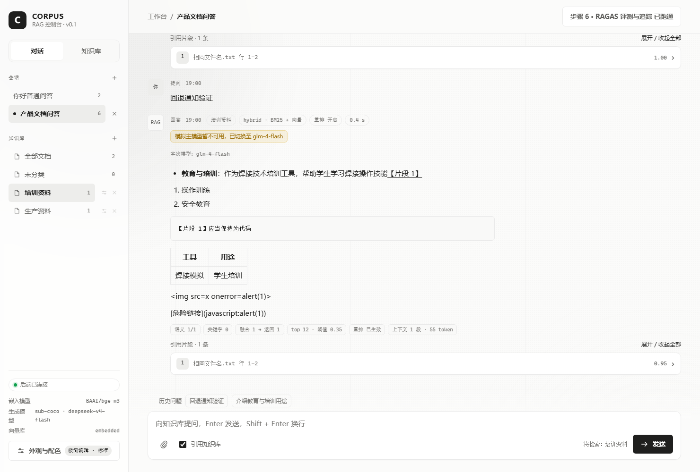
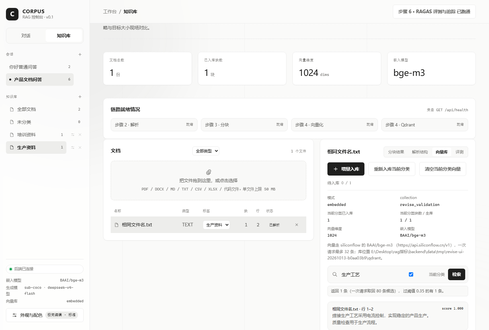
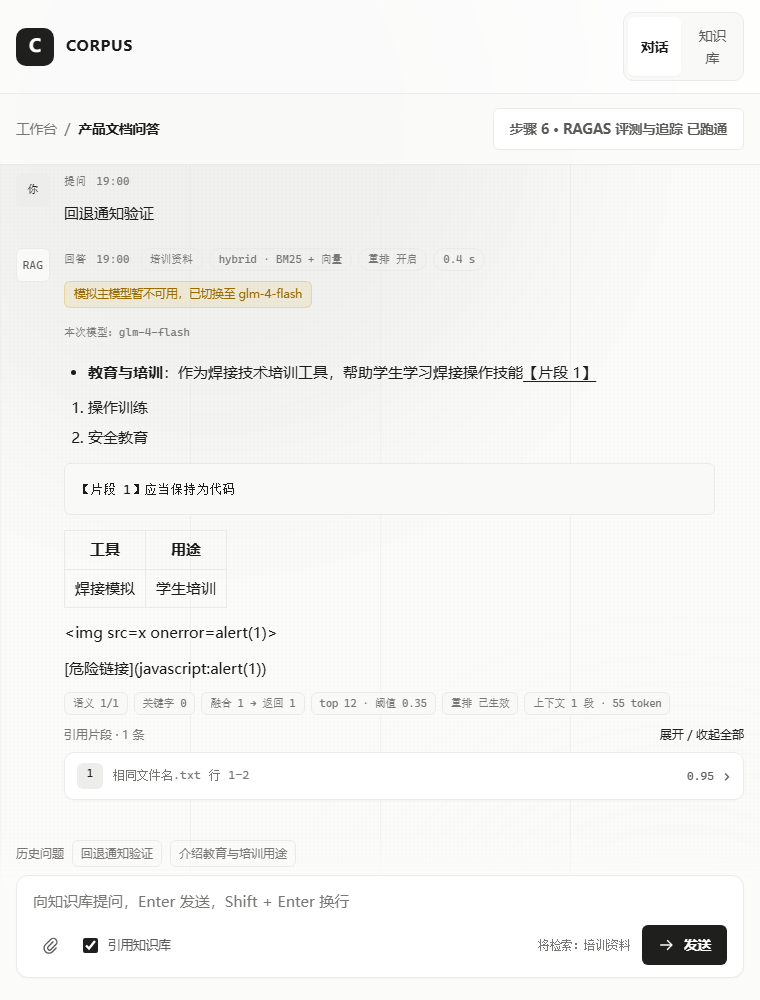

# 六项需求验证记录

日期：2026-10-13。详细方案与完成记录见 [revise.md](../../revise.md)。

浏览器使用真实 Flask 接口、上传/解析/分块和 embedded Qdrant。embedding、rerank 与生成使用固定模拟结果，服务端和浏览器阻止外部 HTTP。没有调用真实付费模型；截图中的回答及 GLM 切换提示均为模拟结果。

每次启动验证服务都会创建独立的 `backend/data/tmp/revise-ui-20261013-<随机后缀>/`，包含上传、文档和分类注册表、索引状态、Qdrant、评测数据与报告。`evidence.json` 保存本次范围请求与最终向量点数；它不包含 API 密钥。

## 复现

先运行前端构建，再在两个终端运行验证服务和浏览器脚本：

```powershell
Set-Location 'E:/Desktop/rag指标/frontend'
npm.cmd run build

Set-Location 'E:/Desktop/rag指标/backend'
& './.venv/Scripts/python.exe' scripts/verify_revise_server.py

# 另一个终端；第二个参数可指向已安装 Playwright 的 Node 依赖目录。
Set-Location 'E:/Desktop/rag指标'
node scripts/verify_revise_ui.mjs 'C:/Users/渝/.cache/codex-runtimes/codex-primary-runtime/dependencies/node'
```

验证使用 `127.0.0.1:5002`，不会代理日常服务。再次运行浏览器脚本前重新启动验证服务，以创建新的隔离数据。完成后 Ctrl+C 关闭服务。

## 浏览器场景

- 创建空标签、刷新恢复；按分类上传和入库同名但内容不同的文档。
- Markdown 加粗、列表、代码和表格；禁止恶意 HTML 与危险链接执行。
- 引用片段默认关闭、逐条展开和引用定位；四种主题下卡片保持紧凑。
- 参数框外部点击/Escape 关闭，内部控件可操作。
- 当前会话的问题去重、点击回填不发送；新会话没有旧问题/草稿；模式刷新后保留。
- 模拟模型回退通知和实际模型显示。
- 分类向量清空保留其他分类；语义搜索片段默认折叠；文档移动复用向量。
- 标签重命名与删除空标签；760px 布局无横向页面溢出。
- 聊天区内部滚动，输入框保持可见。

## 截图







后端 **161 项通过**；前端 **12 项通过**，类型检查和构建均通过；浏览器脚本 11 个场景全部通过。

最终生产文档注册表、索引状态、最新评测报告和 `.env` 与实施前 SHA256 一致。日常服务只读核查返回 7 份文档、56 个向量点；生产目录没有创建测试标签。5002 隔离服务已关闭，日常后端 5000 和前端 5173 正常。
